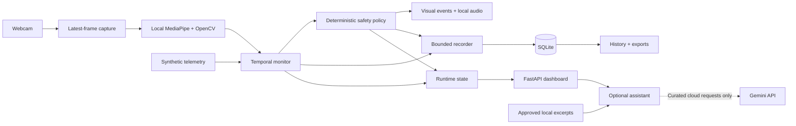

# DMS

**Local driver monitoring, deterministic alerts, and inspectable session history.**

DMS is a webcam-based driver-monitoring demonstration built with Python, FastAPI, OpenCV, and MediaPipe. It turns visible facial geometry into time-based monitoring signals, presents them in a local dashboard, and records sessions in SQLite. Optional local voice and Gemini assistance sit alongside monitoring; urgent alerts do not depend on an LLM, a microphone, or an internet connection.

[Get started](#get-started) · [Architecture](#architecture) · [Documentation](docs/README.md) · [Verification](docs/verification.md)


> DMS is a supervised demonstration, not a certified vehicle-safety system. Its scores are heuristics, not diagnoses, accuracy estimates, or assessments of fitness to drive. Demonstrate it while stationary. If you feel tired, stop at a safe place and rest regardless of the displayed score.

## What you can do

| Capability           | Current behavior                                                                                                                         |
| -------------------- | ---------------------------------------------------------------------------------------------------------------------------------------- |
| Webcam monitoring    | Process one face locally; display eye aspect ratio, mouth opening, head pose, eye-closure duration, and rolling PERCLOS.                 |
| Reproducible replay  | Run a labeled, 30-second synthetic telemetry fixture without camera access. Replay exercises state and alert logic, not image detection. |
| Calibration          | Collect 20 valid frontal-face seconds within 60 seconds; save an eye-aspect baseline for the default local profile.                      |
| Deterministic alerts | Apply sustained score thresholds, prolonged-closure escalation, recovery hysteresis, controlled reminders, and acknowledgement.          |
| Local history        | Store sampled metrics and events; inspect reports and export JSON, CSV, or printable HTML.                                               |
| Grounded assistance  | Explain local status, retrieve approved local excerpts, or explicitly request curated Gemini questions and synthetic scenarios.          |
| Optional voice       | Capture five seconds on request, transcribe locally with Whisper, and use macOS speech output. Typed interaction remains available.      |

No heart-rate measurement, gaze classification, trained fatigue prediction, vehicle control, fleet backend, or continuous microphone listening is implemented. Mouth opening and head turning are observable signals; they are not proof of yawning or distraction.

## Get started

### Requirements

- **Python 3.12**, Git, and [uv](https://docs.astral.sh/uv/getting-started/installation/).
- **Apple Silicon macOS** for the locally exercised webcam, microphone, and speech path. Linux is used by CI; desktop hardware remains unverified. Native Windows startup is currently blocked by Unix file locking. See [platform support](docs/setup.md#platform-support).
- Internet for initial dependency/model installation. Core monitoring and replay then run locally.

Run from a source checkout; standalone wheel installation is not the supported distribution path.

```sh
git clone https://github.com/aman-bhaskar-codes/dms.git
cd dms
uv python install 3.12
uv sync --locked
uv run --locked dms check
uv run --locked dms run --replay
```

Open **http://127.0.0.1:8000**. The replay is artificial and labeled as such. Click **Stop session** when finished; reaching the fixture's end does not finalize the session automatically. Use **Ctrl+C** in the terminal to shut down the server and release resources.

The face model is included in the repository. If its readiness check reports missing or mismatched content, restore it explicitly:

```sh
uv run --locked dms setup-models
```

For a stationary webcam demonstration, run `uv run --locked dms run`, choose **Start webcam**, grant camera permission, then open **Setup → Start calibration**. Replay does not calibrate a real face.

[Detailed installation, permissions, and platform guidance →](docs/setup.md)

## Optional assistance and voice

Install the extras you want. Keep the same extras on later `uv sync` commands so optional packages are not removed.

```sh
uv sync --locked --extra gemini --extra knowledge --extra voice
uv run --locked dms setup-models --knowledge --voice
```

For Gemini, copy `.env.example` to `.env` and set `GEMINI_API_KEY` **only on the backend**. Skip the copy if you already have an environment file. The configured model is selectable through `GEMINI_MODEL`; access, quotas, and billing depend on your provider project.

```sh
# macOS / Linux: run only if .env does not already exist
cp .env.example .env
```

After editing Gemini settings, choose **Assistant → Reload assistant settings**. This reloads the key, model, and application limits without restarting monitoring. It does not reload every application setting.

| Interaction                  | Processing and data boundary                                                                     |
| ---------------------------- | ------------------------------------------------------------------------------------------------ |
| Get local status             | Deterministic explanation of the current local snapshot.                                         |
| Ask locally / Record locally | Local templates and retrieval; arbitrary typed questions and transcripts are not sent to Gemini. |
| General knowledge            | Sends a predefined question plus approved excerpts when explicitly selected.                     |
| Synthetic demo               | Sends a predefined artificial scenario plus approved excerpts; never actual trip history.        |

Cloud generation has one active worker, three waiting slots, a maximum of 20 attempts per UTC day, at least ten seconds between attempts, a 15-second generation deadline, and a 512-token output cap. Usage is persisted. Missing keys, provider errors, invalid citations, or application limits normally return clearly labeled local guidance when evidence exists. A full queue returns a busy response. Citation IDs are checked; semantic correctness is not automatically proven.

Core operation has no recurring service requirement. Cloud requests may incur charges if billing is enabled on your provider account; local caps do not enforce a free tier. See [assistant behavior](docs/assistant.md) and [privacy](docs/privacy.md).

## Architecture



A sequential perception worker owns MediaPipe; capacity-one buffers replace obsolete frames and results. Safety evaluation happens directly before optional event publication. WebSockets poll the latest runtime state with bounded send timeouts; slow browsers do not execute safety logic. Reports use stored samples, not generated interpretations.

[Component responsibilities and lifecycle →](docs/architecture.md) · [API contracts →](docs/api.md)

## Technical stack

| Layer                     | Technology                                                                                        |
| ------------------------- | ------------------------------------------------------------------------------------------------- |
| Runtime and configuration | Python 3.12, asyncio, Pydantic Settings, uv lockfile                                              |
| Perception                | OpenCV, MediaPipe Face Landmarker on CPU, EAR/MAR geometry, approximate head pose with `solvePnP` |
| Local web application     | FastAPI, Uvicorn, REST, WebSockets; plain HTML/CSS/JavaScript with locally served assets          |
| Persistence               | SQLite WAL, `aiosqlite`, batched writes and profile-scoped queries                                |
| Knowledge                 | Built-in BM25-style lexical scoring; optional SentenceTransformers, Chroma, and rank fusion       |
| Intelligence              | Optional official `google-genai` SDK with stateless Interactions requests                         |
| Voice                     | Optional Faster-Whisper and sounddevice; macOS `say` for serialized speech                        |
| Verification              | pytest, pytest-asyncio, Ruff, focused mypy, Playwright, GitHub Actions                            |

## Current status and evidence

The current application includes the six dashboard views, offline replay, local monitoring, reports, assistant fallbacks, and explicit model setup. Hardware checks have been exercised on one Apple Silicon Mac, not a broad device matrix.

Recorded evidence includes a 15.05-second webcam run at **23.26 processed FPS** with **22.72 ms P95 application capture-to-state latency**, plus local microphone, speech, and retrieval checks. This is a short historical observation, not a guaranteed benchmark. The committed synthetic soak evidence covers **30 seconds**, not an hour. Full human calibration acceptance, device variation, and the one-hour physical-camera/memory soak remain outstanding.

See the [verification record](docs/verification.md) for provenance, command results, definitions, and limits. Test instructions are in [Contributing](docs/contributing.md); CLI commands and configuration are documented in [Setup](docs/setup.md) and [Configuration](docs/configuration.md).

## Documentation

- [Documentation index](docs/README.md) — choose a user or contributor path.
- [Setup](docs/setup.md) · [Configuration](docs/configuration.md) · [Troubleshooting](docs/troubleshooting.md)
- [Guided demo](docs/demo.md) · [Assistant and retrieval](docs/assistant.md) · [Privacy and storage](docs/privacy.md)
- [Architecture](docs/architecture.md) · [Component reference](docs/components.md) · [API reference](docs/api.md)
- [Verification](docs/verification.md) · [Contributing](docs/contributing.md) · [Design specification](docs/design/implementation.md)

Repository source and model assets have separate licensing considerations. The repository currently has no top-level license grant; consult the [model manifest](models/manifest.json) and upstream terms before redistribution.
