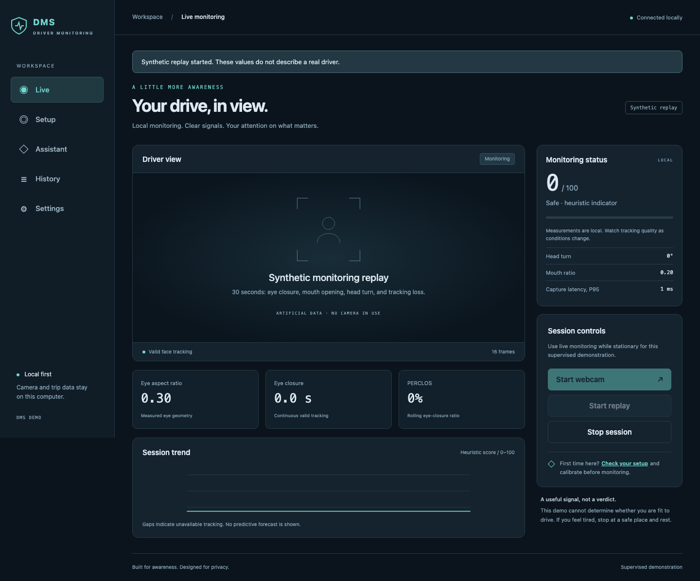

# DMS

A local driver-monitoring **demonstration** for Apple Silicon Macs. Webcam geometry, deterministic alerts, guided calibration, session history, reports, and replay run entirely on-device. An optional Gemini assistant answers curated general questions and analyzes synthetic scenarios using approved local documentation excerpts.



> [!IMPORTANT]
> **Supervised Demonstration Limitations:** DMS is an experimental research prototype and technology demonstrator. It is not an automotive-grade or certified safety product. Fatigue scores and alert levels are heuristic indicators based on visible facial geometry; they do not assess medical condition or legal fitness to drive. Always rest when fatigued.

---

## Working Flow

```
[Camera / Replay] ──► [Perception] ──► [Temporal Monitor] ──► [Safety Policy] ──► [Alerts / Audio]
                          │                   │                      │
                          ▼                   ▼                      ▼
                    Landmarks 3D        PERCLOS, EAR,           Deterministic
                   (solvePnP Pose)    Heuristic Score (0-100)    Transitions
                                              │
                                              ▼
                                    [SQLite Local Storage] ◄──► [Web Dashboard]
```

1. **Capture:** Ingests live frames from a webcam or a deterministic 30-second synthetic replay fixture.
2. **Local Perception:** Resizes frames into a 640×480 canvas, tracks 478 3D facial landmarks using MediaPipe on CPU, calculates Eye Aspect Ratio (EAR) and Mouth Aspect Ratio (MAR), and estimates head pose (pitch/yaw/roll) using OpenCV SQPNP `solvePnP`.
3. **Validated State:** Evaluates rolling 60-second time-weighted PERCLOS, measures consecutive eye closure, and computes a 0–100 composite fatigue score. Missing faces trigger an `unavailable` state; loss of head pose triggers `degraded` mode without fabricating zero readings.
4. **Deterministic Alerts:** Applies fixed safety thresholds (warning at 55, critical at 72, immediate critical on eye closure $\ge 1.5\text{s}$), 5-point exit hysteresis, and 3-second recovery stabilization.
5. **Dashboard & History:** Telemetry streams to the browser via loopback WebSockets at 5 Hz; metrics are downsampled to 1 Hz in SQLite WAL storage for reporting and export.

---

## Architecture

The safety-critical monitoring pipeline is completely local and decoupled from cloud inference:

```mermaid
flowchart TD
    subgraph Local["On-Device Pipeline (Privacy Boundary)"]
        Cam["Webcam / Replay Fixture"] --> Latest["LatestProcessor (Capacity 1)"]
        Latest --> Pipe["Perception (MediaPipe + solvePnP)"]
        Pipe --> Mon["Monitor (PERCLOS, EAR, MAR, Pose)"]
        Mon --> Safety["Safety Policy (State Machine)"]
        Safety --> Alert["Alert Engine (macOS 'say' Audio)"]
        Mon --> Store[("SQLite Storage (WAL)")]
        Safety --> Store
        Mon --> WS["WebSocket Hub (5 Hz Telemetry)"]
        WS --> UI["Web Dashboard (Local Browser)"]
    end

    subgraph Cloud["Optional Cloud Path (Isolated)"]
        UI -.->|Curated Topic / Scenario| Assist["Assistant Service"]
        KB[("Approved Docs Excerpts")] --> Assist
        Assist -.->|Standard Tier (store=False)| Gemini["Google Gemini API"]
        Gemini -.->|Structured JSON + Citations| Assist
    end
```

---

## Technical Stack

| Component | Technology | Purpose |
| --- | --- | --- |
| **Vision Worker** | MediaPipe Face Landmarker | Extracts 478 facial landmarks on CPU without remote telemetry. |
| **Geometry** | OpenCV (`solvePnP`) | Estimates 3D head pose angles from 6 canonical facial points. |
| **Backend & Web** | FastAPI, Uvicorn, WebSockets | Serves local REST APIs and streaming telemetry over loopback (`127.0.0.1`). |
| **Storage** | SQLite, `aiosqlite` | Bounded batched storage for session metrics (1 Hz), events, and quotas. |
| **Speech Audio** | Native macOS `say` | Serialized audible voice alerts with critical alert preemption. |
| **AI Assistant** | `google-genai` SDK 2 | Optional curated Q&A with strict schema and local citation checking. |
| **Local Search** | ChromaDB, Sentence-Transformers | Optional on-device hybrid semantic retrieval (dense + BM25). |
| **Local Voice** | `faster-whisper`, `sounddevice` | Optional push-to-talk microphone capture and on-device transcription. |

---

## Quick Start

Requires Python 3.12 and [uv](https://docs.astral.sh/uv/). Clone the repository and install dependencies:

```sh
git clone https://github.com/aman-bhaskar-codes/dms.git
cd dms
uv sync --locked --extra gemini
uv run dms check
uv run dms setup-models
uv run dms run
```

Open **http://127.0.0.1:8000** in your browser. Choose **Start replay** to evaluate the 30-second synthetic scenario, or **Start webcam** while stationary. For automatic replay launch:

```sh
uv run dms run --replay
```

Application startup never downloads models automatically; `uv run dms setup-models` verifies asset checksums locally before execution.

---

## Environment Configuration

Copy the example environment file to `.env`:

### POSIX Shell (macOS / Linux)
```sh
cp .env.example .env
```

### PowerShell (Windows)
```powershell
Copy-Item .env.example .env
```

Set `GEMINI_API_KEY` on the backend if cloud assistance is desired. Never expose keys in browser client code. `GEMINI_MODEL` defaults to `gemini-3.5-flash-lite`. Verify model access in [Google AI Studio](https://aistudio.google.com/).

> [!NOTE]
> **Inherited Storage Directory:** SQLite databases, calibrations, and settings are saved under `data/sentinel/sentinel.db`. This path is intentionally preserved across updates to maintain your historical sessions, driver calibrations, and daily quota tracking without data migration.

---

## Optional Knowledge and Voice Extras

Core operation works fully offline. Two optional enhancements can be installed:

### 1. Hybrid Knowledge Retrieval
Installs local sentence-transformers embeddings, ChromaDB, and BM25 rank fusion:

```sh
uv sync --locked --extra gemini --extra knowledge
uv run dms setup-models --knowledge
```

### 2. On-Device Voice Push-to-Talk
Downloads the local quantized Whisper model for 5-second microphone transcription:

```sh
uv sync --locked --extra gemini --extra knowledge --extra voice
uv run dms setup-models --knowledge --voice
```

In Assistant, click **Record locally · 5 sec** to capture audio, transcribe on-device, and answer fatigue, status, or calibration queries. The microphone is never active outside this 5-second window.

---

## Features and Capabilities

- **Webcam Monitoring:** Real-time facial tracking, EAR, MAR, pitch, and yaw.
- **Guided Calibration:** Requires 20 valid frontal-face seconds within a 60-second stationary window to establish an individualized EAR baseline.
- **Deterministic Alerts:** Multi-tier warnings (Warning: 55, Critical: 72) and immediate critical alert on eye closure exceeding 1.5 seconds.
- **Acknowledge & Silence:** Silences active speech alerts without masking the underlying visual safety state.
- **Sandboxed Assistant:** Handles curated general questions and synthetic scenario interpretations; real biometric values, frames, and trip transcripts are strictly forbidden from entering cloud prompts.
- **Reports & Exports:** Review session duration, tracking coverage, event chronologies, and SVG score trends. Export data to JSON, CSV, or printable HTML.

---

## Platform Support

| Platform | Support Tier | Details |
| --- | --- | --- |
| **Apple Silicon macOS** | **Tier 1 (Supported)** | Verified hardware capture, microphone input, native `say` audio, and local neural network execution. |
| **Linux** | **Headless / CI Only** | Supported for Python runtime, unit tests, and synthetic replay. Physical webcam and desktop speech synthesis are unverified; macOS `say` is unavailable. |
| **Windows** | **Not Supported** | Native startup is currently blocked by Unix-specific file locking (`fcntl.flock`). Running in WSL2 requires manual X11/PulseAudio bridging. |

---

## Development and Verification

```sh
# Run unit and integration tests (44 tests)
uv run pytest -q

# Code formatting and linting
uv run ruff check .
uv run ruff format --check .

# Static type verification
uv run mypy

# Playwright browser acceptance test (requires running dms server)
uv run dms run &
SERVER_PID=$!
uv run python scripts/browser_check.py
kill $SERVER_PID

# Accelerated signal-policy load benchmark
uv run python scripts/benchmark.py

# Synthetic replay memory soak
uv run python scripts/soak.py --seconds 3600
```

---

## Documentation Links

- [Architecture and API Reference](docs/architecture.md)
- [Setup and Configuration Guide](docs/setup.md)
- [Demonstration Guide](docs/demo.md)
- [Verification Record and Benchmarks](docs/verification.md)
- [Contributing Guide](docs/contributing.md)
- [Design Contract](DESIGN.md)
- [Interaction Contract](UX-CONTRACT.md)
