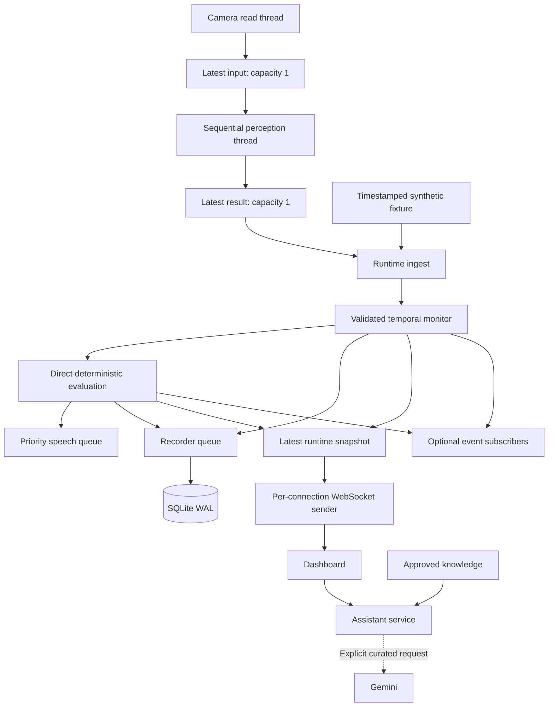

# Architecture

[Documentation index](README.md) · [Component reference](components.md) · [API](api.md)

DMS is a single-machine application: one Python process, one active monitoring session, one default local profile, and a browser dashboard. Python owns device access, inference, alert decisions, storage, and optional assistance. The frontend is plain HTML/CSS/JavaScript served by FastAPI; it has no frontend build or CDN dependency.

## Runtime data flow

**Replay bypasses perception.** It supplies artificial measurements directly to the same monitor and policy used after live inference. It verifies orchestration and alert behavior, not the camera model's accuracy.

The dashboard reads runtime health through WebSockets. It is not an event-bus subscriber, and there is no separate queued telemetry hub. Database recording likewise has its own queue. The event bus is available for optional consumers; safety is evaluated before publication.

## Ownership and concurrency

| Boundary          | Owner / bound                                       | Behavior                                                                                                                                      |
| ----------------- | --------------------------------------------------- | --------------------------------------------------------------------------------------------------------------------------------------------- |
| Camera reads      | One dedicated camera executor                       | Blocking OpenCV calls run outside the event loop. Requested resolution and FPS are device hints.                                              |
| Pending inference | `LatestProcessor`, one input                        | Replace obsolete pending frames; one executor owns MediaPipe and cleanup.                                                                     |
| Pending result    | `LatestProcessor`, one result                       | Replace unconsumed results rather than accumulating delayed telemetry.                                                                        |
| Safety            | Runtime ingest, direct call                         | Validate state, evaluate policy, queue audio, then publish/record. No cloud call in this path.                                                |
| Recorder          | 256 queued records, batches up to 32                | Metrics approximately once per captured second; transitions/unavailability can add records. Overflow raises rather than silently discarding.  |
| Audio             | Eight waiting items                                 | Serialized speech; critical announcements interrupt current speech and clear queued announcements. Normal full-queue submissions are dropped. |
| Event subscribers | 32 items per subscription by default                | Separate consumer tasks; overflow replaces oldest queued events. This channel is not durable storage.                                         |
| Assistant         | One worker, three waiting requests                  | Reject with a busy response if full. Optional retrieval/cloud work stays outside safety evaluation.                                           |
| Telemetry socket  | Latest state every 0.2 seconds                      | One-second send deadline; disconnect slow or failed connections. No per-client backlog queue.                                                 |
| Preview socket    | Latest distinct preview, checked every 0.15 seconds | Same send deadline; skip unchanged frames. This is a preview limit, not inference FPS.                                                        |

Async separation bounds pending work; shared CPU, memory, and operating-system resources can still affect performance. Queues are not a real-time scheduling guarantee.

## Startup

1. Read validated configuration and saved UI preferences through the CLI.
2. Acquire an exclusive file lock in the data directory. A second process using the same directory is rejected.
3. Open SQLite, apply the supported schema, mark interrupted sessions, and expire old completed sessions.
4. Ingest approved documents; start audio, recorder, bus, and maintenance tasks.
5. If installed, load dense retrieval in a background thread. Lexical retrieval remains usable while loading.
6. Start the HTTP server. Camera capture begins only on a live-session request; replay begins only on request or `--replay`.

The face model is lazily opened on the perception worker. Whisper is loaded on the first voice request. Dependency installation and model downloads are explicit setup actions.

## Session lifecycle

A start creates a SQLite session, a fresh monitor and safety policy, and an `initializing` snapshot. The latest saved calibration for the default profile is loaded. Only one active session is allowed.

Capture and perception failures mark monitoring unavailable and append a health event. A 0.5-second maintenance loop detects stale processed state. Live stale inputs are also rejected during ingest. Out-of-order capture times/frame IDs do not update the monitor.

At replay completion, monitoring becomes unavailable with reason `synthetic_replay_complete`. The record remains active until **Stop session** or application shutdown. Stopping cancels capture, releases camera/model resources, silences audio, drains records, and finalizes the session.

Shutdown also closes assistant work, stops optional consumers and maintenance, waits for dense-model initialization if still active, closes SQLite, and releases the file lock. Cold optional model initialization can therefore delay shutdown.

## Failure semantics

| Condition                                     | Observable behavior                                                                                                                                |
| --------------------------------------------- | -------------------------------------------------------------------------------------------------------------------------------------------------- |
| Face or required geometry missing             | Unavailable measurements; score is null. Eye-closure accumulation resets.                                                                          |
| Head pose missing, EAR/MAR valid              | Degraded snapshot; pose invalid, no fabricated zero angles, no yaw contribution.                                                                   |
| Live input too old                            | `stale_capture`; no stale score is accepted.                                                                                                       |
| No fresh processed state                      | `camera_or_inference_stalled` from maintenance.                                                                                                    |
| Capture/perception exception                  | `capture_or_perception_failure`, monitoring component error, and persisted health event.                                                           |
| Recorder write failure                        | Storage error, session task cancellation, and `storage_failure` snapshot. Failed writes are not automatically recovered; stop and inspect storage. |
| Audio unavailable/fails                       | Health error; visual monitoring continues.                                                                                                         |
| Dense loading fails                           | Lexical retrieval remains available.                                                                                                               |
| Missing key / cloud error / invalid citations | Cited local excerpts when evidence exists; explicit limitation otherwise.                                                                          |
| Unsupported browser origin                    | HTTP mutation rejected or WebSocket closed.                                                                                                        |

Unavailable state does not resolve an already active fatigue alert. Conversely, an old alert object is not a fresh measurement: clients must inspect snapshot validity and event transition. [Component details](components.md) explain the distinction between score level and alert state.

## Boundaries and distribution

The HTTP server is loopback-only and has Host checks, mutation-origin checks, explicit WebSocket origins, size limits, and a restrictive Content Security Policy. It has no login, multi-user authorization, TLS deployment, or fleet-service architecture. Loopback is not authentication against other local processes. See [privacy and security](privacy.md).

The supported artifact is a **source checkout with uv**. Frontend files are declared as package data, but the fixture, corpus, and model manifest are read from repository paths. Do not advertise an independently installed wheel or hosted service without additional packaging/deployment work.
