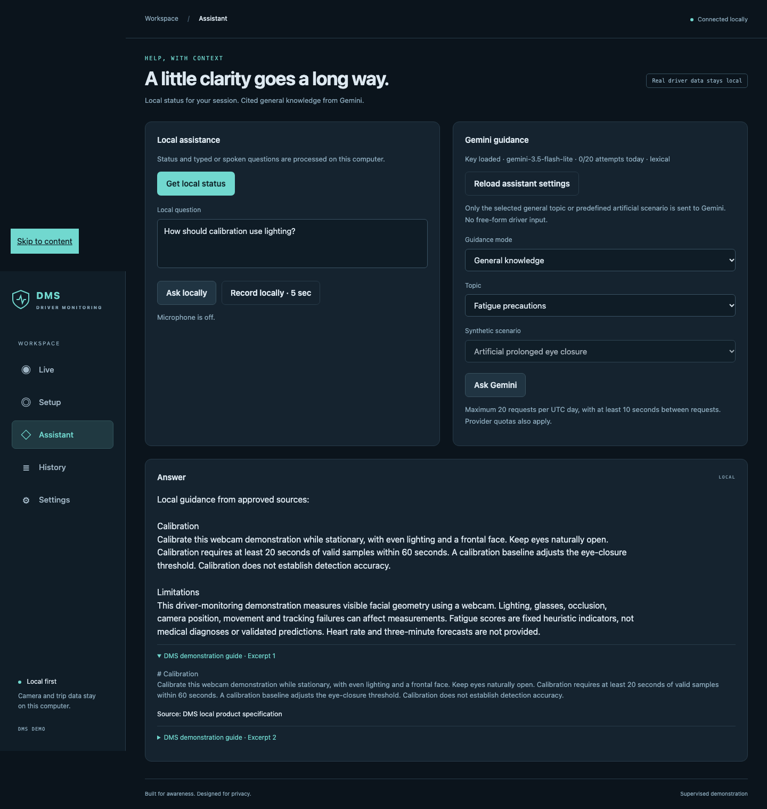

# Assistant and retrieval

[API](api.md#assistant-and-voice) · [Privacy](privacy.md) · [Optional installation](setup.md#add-optional-features)

The assistant helps explain the demonstration. It does not decide alert severity, receive live images, diagnose fatigue, or control a vehicle. Monitoring runs without it.

## Interaction modes

| Mode              | Input                          | Processing                                                                                              |
| ----------------- | ------------------------------ | ------------------------------------------------------------------------------------------------------- |
| Local status      | Current in-memory snapshot     | Deterministic template; no cloud.                                                                       |
| Local question    | Typed text or local transcript | Status/rest/heart-rate limitation templates, otherwise approved local retrieval.                        |
| General knowledge | Selected topic ID              | Server replaces the ID with a predefined general question, retrieves excerpts, optionally calls Gemini. |
| Synthetic demo    | Selected scenario ID           | Server supplies a fixed artificial scenario, never a real session.                                      |

Supported general topics are fatigue signs, breaks, calibration, and monitoring limitations. Synthetic scenarios cover prolonged closure and a fixed artificial trip summary. This is not unrestricted cloud chat. Unsupported local questions receive an evidence limitation; no general web-search feature is implemented.

Local answers can quote approved excerpts rather than synthesize a new narrative. Opening a citation retrieves the actual excerpt from the local API. Markdown/assistant text is rendered as text, not arbitrary generated HTML.

## Local retrieval

The approved corpus is the top-level Markdown/TXT files in `docs/knowledge/`. Other project documentation and real trip history are not automatically indexed. Symlinked files are skipped.

Ingestion reads simple `title`, `source`, and `revision` front matter, computes content checksums, and creates paragraph excerpts capped at 1800 characters. Each excerpt records its ID, file, section label, source, revision, and checksum. Section labels are excerpt numbers, not a formal heading hierarchy.

Built-in lexical search uses BM25-style scoring and stopword filtering. Up to 20 lexical candidates are ranked. With an explicitly installed local embedding model, SentenceTransformers on CPU and a persistent Chroma index add dense ranks using reciprocal-rank fusion. Dense candidates must already have lexical overlap; this acts as a conservative guard for the small corpus. At most five excerpts are returned. There is no HyDE, reranker, hosted vector database, or automatic web ingestion.

The running application ingests at startup. The ingestion function can update changed/removed files without rewriting unchanged embeddings, but no public upload endpoint, file watcher, or periodic reindex job is wired in. **Restart after editing the approved corpus.** Assistant-settings reload does not reindex documents. Citation identifiers are position-based; recheck grounding after corpus edits.

## Gemini boundary and limits

The backend uses the official Python `google-genai` SDK and [Interactions API](https://ai.google.dev/gemini-api/docs/interactions-overview). Requests set `store=False`, standard service tier, a structured JSON response schema, and explicit output/reasoning limits. This does not override Google's service terms or guarantee that a provider retains no data.

Only the selected predefined question/scenario and up to five approved excerpts enter the prompt. The prompt treats excerpts as data and asks for at most three sentences with supporting excerpt IDs. The cloud request has no route for arbitrary local questions, transcripts, driver IDs, raw media, actual measurements, or history.

| Application control   | Current implementation                                                                                                            |
| --------------------- | --------------------------------------------------------------------------------------------------------------------------------- |
| Concurrency           | One active cloud worker, three waiting slots.                                                                                     |
| Daily usage           | Maximum 20 outbound attempt reservations per UTC day; configurable downward to zero.                                              |
| Spacing               | At least ten seconds between reserved attempts.                                                                                   |
| Deadline              | 15 seconds around provider generation/retry; excludes queue wait and initial retrieval.                                           |
| SDK timeout / retries | 14-second request timeout; SDK hidden retries disabled.                                                                           |
| Output                | Maximum 512 generated tokens; displayed answer additionally bounded to 2000 characters.                                           |
| Transient retry       | At most one retry for 500/502/503/504, with a new persisted reservation and normal spacing, only if the overall deadline permits. |
| Billing               | No paid-model fallback or tool orchestration. Application caps do not control provider billing configuration.                     |

Usage reservations count attempts, including failed or timed-out calls, rather than successful answers or provider tokens. They survive restarts. The cap is local to this database, not a provider-wide quota or tamper-resistant billing guard. Do not remove the usage database to bypass it.

Review [Google's service terms](https://ai.google.dev/gemini-api/terms), [pricing](https://ai.google.dev/gemini-api/docs/pricing), and [rate limits](https://ai.google.dev/gemini-api/docs/rate-limits) for your account. No particular free-tier entitlement or ongoing model availability is promised by DMS.

## Responses and fallback

A generated response is accepted only if it has a nonempty string answer, at least one citation, and citation IDs drawn entirely from the supplied excerpts. This checks identifiers, **not whether every generated claim is supported**. Human evaluation remains necessary; a plausible citation is not a correctness score.

Missing configuration, usage/spacing limits, provider errors, deadlines, or invalid cited output return local excerpts when available and an explicit limitation. Empty evidence leads to abstention. Queue saturation returns “Assistant is busy”; unexpected retrieval/worker failures can produce an unavailable response. None of these failures changes deterministic monitoring decisions.

The response source is `local`, `gemini`, or `synthetic`. A cloud-mode fallback is still labeled `local`. Source and limitation should stay visible in demonstrations and exports of any assistant content.

## Configuration and reload

Install the `gemini` extra, set the backend key and model in `.env`, then select **Reload assistant settings**. A configured status means a provider object exists; it is not an authentication or live-generation check. The status panel includes model, usage, interval, retrieval readiness, and the last cloud-worker outcome.

Reload is serialized and rejected while requests are active/queued. It swaps the provider without restarting camera monitoring or resetting counters. Environment variables override `.env`, so changing the file may not change a value exported in the launching shell.

## Local voice

Optional push-to-talk uses sounddevice and Faster-Whisper in English, on CPU with int8 inference and voice-activity filtering. The model loads lazily before capture; the first request can therefore take longer. Five seconds of audio are held in memory, the transcript is bounded to 1000 characters, and the local API returns it to the browser. It is not automatically persisted or sent to Gemini.

Spoken answers use the same serialized macOS speech worker as alerts. Critical alerts can preempt informational speech. Microphone failure leaves typed local interaction available. Linux/native Windows speech parity is not implemented.
